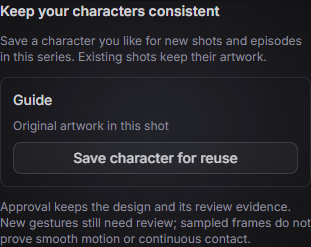
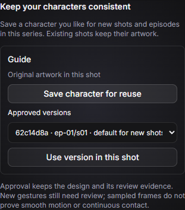
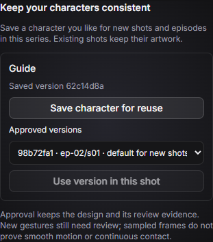
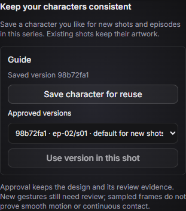

# Approved reusable characters

Canvas artist productions can retain a character the user likes as a reusable,
editable rig within that series. This builds on the existing shared artwork,
immutable shared design versions, Canvas acting helpers and kit rigs. It does
not add a fixed pose catalog or turn successful sampled frames into a motion guarantee.

## Using it

1. Open a shot on the episode page after its current sample/cut passes visual review.
2. Inspect the result and choose **Save character for reuse** for a cast member.
   This is a separate human approval of the exact saved scene hash. Saving makes
   no model call and changes no existing shot.
3. New shots featuring that cast ID receive the approved version automatically,
   including in later episodes. Existing shots retain their own embedded source
   and exact version pins. Existing/original artwork without a pin stays original.
4. To improve a design, author a new shared version and review its source shot,
   then save that character again. This becomes the default for new shots.
5. To change an existing shot, select an approved version and choose **Use version
   in this shot**. The selected provider adapts only that shot to the rig; the
   whole episode is reviewed without automatically repairing other shots. Failed
   or interrupted upgrades restore the previous scene, editable shot files and displayed stills.
   Render and approve a fresh preview afterwards. A failed/stale quality report
   continues to block final export.

Saving is unavailable while a generation job or another character approval is
running. Stale scene approval, changed editable source/images, stale narration or
cuts, and incomplete/failing review evidence are rejected. Existing projects and
kit/world scene formats still work without the new artifacts.

## Storage and integration contract

- `artifacts/characters/library.json` is a `CharacterLibrary` artifact. Each cast
  member has an `activeVersion` and an append-only list of approved versions.
- `artifacts/characters/<castId>/<version>.json` is an immutable `CharacterRig`
  artifact. `version` is the SHA-256 content hash of `{castId,sources,assets,notes}`.
  It stores editable shared JS source, embedded image bytes and design notes.
  Provenance records the source episode/shot/scene hash, producing backend,
  human approval time, critique/report hashes and observed acceptance evidence.
  Repeat saves of identical content preserve the first approval and asset bytes.
- `SceneSpec.canvas.characterRigs` maps cast IDs to exact version hashes. An empty
  mapping explicitly identifies original artwork. The complete composed source
  and images remain embedded in every scene, so rendering older shots does not
  require the source workspace or the current library default.
- Engine APIs: `listCharacters(seriesId)` returns approved versions, provenance
  and dependent shots; `saveCharacter(ShotRef,{castId,sceneHash})` records approval;
  `applyCharacter(ShotRef,{castId,version,sceneHash})` starts an upgrade/review job.
  These also work through the engine host/client protocol and desktop IPC.
  Character approval shares the engine's project mutation lock and respects
  approved style-sample revisions; those samples cannot be changed through reuse APIs.
- The episode-page controls are a small entry point. The editing workstream can
  use these APIs for its wider UI. Repeat workflows can use the library when
  creating new shots; no sibling branch/worktree changes are required here.

## Artist authoring

`brief.json` supplies `characterRigs` and read-only virtual
`approved-characters/<castId>.json` files with the selected source functions,
notes and available image IDs. Both Codex and Claude use the existing shared
artist tool contract. No provider is selected or substituted by this feature.

An approved rig is automatically composed before a shot's `sourceFiles`, and its
images are injected into `scene.assets`. For example:

```json
{
  "sourceFiles": ["shots/s02/draw.js"],
  "cast": ["guide"],
  "characterRigs": {"guide": "<approved 64-character version hash>"},
  "assets": {},
  "cues": []
}
```

The author calls the retained functions in `draw.js` and can write bespoke motion.
Do not load an older shared implementation on top of an approved rig. Identical
shared paths are deduplicated and conflicting source/image definitions fail
visibly. Omitting `characterRigs` uses the shot brief's defaults. To make a new
candidate, set `characterRigs:{}` and use new files under `shared/versions/`.
An explicitly requested version upgrade must retain the selected pins.

## Limits

- This first asset type is a character's shared Canvas code bundle. The existing
  workspace can put several characters/helpers in one file; saving retains all
  referenced shared source and the source shot's image assets. It does not infer
  which JS function or raster region belongs to one character. Author separate
  shared files and image IDs when characters need independently compatible rigs.
- Shared code must be authored as reusable functions/helpers. Shot-specific
  timing and drawing remain in the shot files. There is no automatic rig conversion,
  pose retargeting, gesture library, interaction library or cross-series import.
- Design approval does not certify every action. The benchmark still documents
  weak elbow support, curtain contact, gaze and palm orientation, plus variable
  reviewer verdicts. The asset retains its evidence and an explicit limitation:
  sampled frames cannot prove continuous smoothness or contact. Every new shot
  still goes through ordinary visual review and final-export gating.
- Code inclusion and cast declarations alone do not prove that an artist drew
  the intended character. Visual inspection remains necessary. Incompatible
  character bundles may require deliberately authored compatible versions.

## Verification

### Desktop screenshots

`pnpm --filter @moco/desktop test:character-reuse` exercises the actual
Electron/preload/React controls using a fresh temporary profile and deterministic
IPC fixtures. It checks exact approval/upgrade payloads, retained old pins,
version selection, and error recovery, without a live model or changes to the
user's profile. Captures are written to `artifacts/character-reuse-ui/`.
The checked-in screenshots below document control behavior, not live-generated art:

| Save a reviewed character | Saved version available for new shots |
| --- | --- |
|  |  |

| Choose v2 while the existing shot still uses v1 | Only the selected shot now uses v2 |
| --- | --- |
|  |  |

### Engine and renderer

`packages/engine/test/characters.test.ts` uses fake model/audio/render ports for
approval, provenance, immutable bytes, drift/staleness rejection, unapproved
version rejection, source ordering, cross-episode reuse, dependency reporting,
selected-shot upgrades and failed-upgrade rollback. It makes no live model calls.
The existing artist/review and real-browser Canvas renderer tests also apply.

The focused browser check can use an already installed Chromium executable:

```powershell
$env:MOCO_RENDER_TESTS='1'
$env:MOCO_TEST_BROWSER='C:/Program Files/Google/Chrome/Application/chrome.exe'
pnpm exec vitest run packages/engine/test/characters.test.ts -t 'renders retained character' --maxWorkers=1
```

It renders the retained bundle after removing the original shared source file,
seeks out of order, checks visible pixels and verifies a repeated frame is identical.
This tests deterministic reuse, not production acting quality.

Verified on 2026-11-08:

- `pnpm typecheck`: passed, including desktop.
- `pnpm --filter @moco/desktop build`: passed.
- `pnpm exec vitest run --exclude packages/ai/test/claude-cli.test.ts --exclude packages/kit/test/art.test.ts --maxWorkers=1 --testTimeout=20000`:
  320 passed, 14 skipped. The two exclusions retain the documented Windows
  fake-Claude executable and kit art CRLF/LF fixture limitations; this is not
  an unfiltered-suite pass. The 40-shot stress test passed in this run.
- Focused retained-character browser test above: passed using installed Chrome,
  including source removal and out-of-order/repeated frame checks. The full opt-in
  Canvas browser suite was stopped during its slow headless-shell download;
  no full-suite browser pass is claimed.
- No live model calls or paid generation runs were used. This is integration
  verification, not a new acting-quality benchmark.
